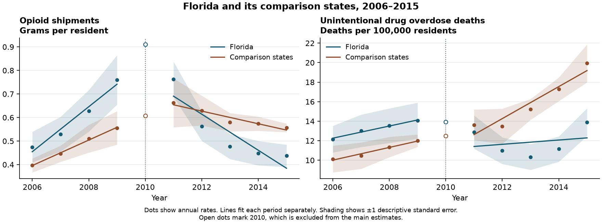
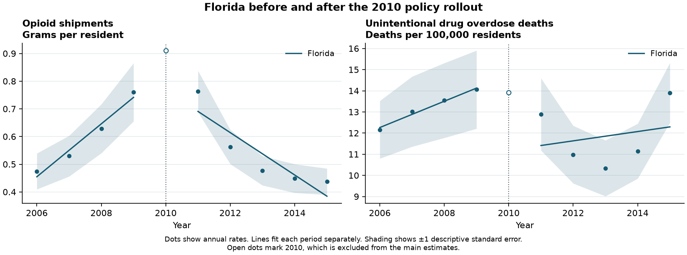

# Florida's opioid prescribing crackdown

**Policy memo for the Florida Department of Health overdose prevention team**

Florida's recorded opioid shipments and unintentional drug overdose mortality fell relative to Delaware, Pennsylvania, and Michigan after the 2010 crackdown began. From 2006–2009 to 2011–2015, the difference-in-differences was **−0.184 grams of opioid shipments per resident** and **−6.26 unintentional drug overdose deaths per 100,000 residents in counties with reported counts**. These are historical comparisons. They cannot isolate the effects of individual enforcement actions or laws.

| Outcome | Change in Florida | Change in comparison states | Florida change minus comparison change |
| --- | ---: | ---: | ---: |
| Recorded opioid shipments, grams per resident | −0.060 | +0.123 | **−0.184** |
| Unintentional drug overdose deaths per 100,000 residents in reporting counties | −1.34 | +4.92 | **−6.26** |



Florida's shipment rate peaked in 2010 and was below the comparison average by 2012. Oxycodone accounted for about 73% of the net shipment difference by weight. Florida's observed overdose death rate fell through 2013, then rose to 13.9 in 2015, close to its 2009 rate of 14.1. The comparison average rose from 12.0 to 19.9 over those same years.

**What this means for surveillance.** Track opioid shipments and overdose mortality separately when evaluating prescribing rules. For questions about substitution to illicit opioids, pair shipment monitoring with drug-specific mortality and treatment access measures. The shipment records cover purchases by community pharmacies and practitioners and are measured in base-weight grams. They cannot measure patient prescriptions, potency-adjusted doses, or illicit supply. The available mortality data group unintentional overdoses by intent and cannot identify the substances involved.

## How the comparison was built

Florida began a series of enforcement and prescribing changes in 2010, with major additional steps in 2011. The main comparison uses 2006–2009 and 2011–2015, with 2010 treated as a transition year. The plots include 2010 for context. [CDC account of Florida's rollout](https://www.cdc.gov/mmwr/preview/mmwrhtml/mm6326a3.htm)

The analysis reuses the county policy panel, state policy history, state context, and drug-level Parquet outputs prepared in PR #6 at `77b2f9c`. County eligibility is outcome-specific. County rates use annual population weights within each state-year, and each comparison state and each year within a period receives equal weight. The pre-post is the change in Florida's period means. The DiD subtracts the comparison states' average change, equivalent to the interaction coefficient from a saturated two-group, two-period regression weighted to give equal weight to years within each group-period. County-year eligibility and population coverage are available in the [coverage table](../outputs/florida_analysis/coverage.csv).

The control screen excludes Alaska, DC, the two focal states, states with unknown policy coverage near the intervention, states with any of the five tracked adoptions in 2009–2011, and states with an active pain-clinic law in 2010. Candidates need outcome coverage in every year and at least 50% of the state population observed for each outcome in every pre-policy year. The score uses standardized distances in each year's change from 2006 for shipments and mortality (40% each), plus distances across average pre-policy unemployment, median household income, age 65+ share, and physician availability (20%). Average physician availability uses 2006–2008 because 2009 is missing for all states. Each feature is scaled by its standard deviation among eligible states. See the [full candidate ranking and adoption history](../outputs/florida_analysis/control_selection.csv).

Only Missouri had no tracked adoption from 2006 through 2015. Delaware adopted two PDMP policies in 2012, a Good Samaritan law in 2013, and a naloxone access law in 2014. Pennsylvania adopted naloxone access and Good Samaritan laws in 2014, and Michigan adopted a naloxone access law in 2014. The policy screen covers five categories and can miss amendments, enforcement changes, and other policies. See the [state policy documentation](state_policy.md).

## How much confidence to place in the comparison

- **Shipments.** The gap between Florida and the controls was growing by about 0.041 grams per resident per year before the crackdown. The level comparison depends on what would have happened to that gap without the policy. Extending its linear pre-trend yields −0.411 grams per resident, while excluding county-years with flagged large or single-transaction shipments yields −0.072. The estimates agree on direction and differ materially in magnitude.
- **Deaths.** The pre-policy mortality gap was comparatively stable. Reported counts cover about 89–95% of Florida's population and 60–75% of Michigan's population over the study. Restricting to counties with observed counts in every year gives −6.17 deaths per 100,000. A sensitivity exercise allowing 0–9 deaths only for absent D1 counts with an upstream bound yields a conditional DiD range of −10.37 to −1.61. Explicitly missing counts, county-years absent from the source, and noncomparable geographies stay excluded. This range reflects the assumed missing-count limits on an expanded sample and does not quantify statistical uncertainty.
- **Timing and comparison states.** Counting 2010 as post yields −0.123 grams per resident and −5.35 deaths per 100,000. Limiting the post-period to 2011, before the selected controls had additional tracked adoptions, yields −0.021 and −2.95, respectively. Restricting to controls with no later tracked prescribing-policy adoptions gives −0.178 and −5.41. See [all checks](../outputs/florida_analysis/estimates.csv).
- **Uncertainty.** Figure bands show one descriptive standard error on each side of the annual rate, using a leave-one-county jackknife for Florida and variation across the three comparison states for their average. They describe annual rate variability under those calculations. A comparison with one treated state and three selected controls cannot use those bands to establish policy-effect significance.

## Appendix and reproduction



Run from the repository root using the checked-in analysis inputs.

```sh
python -m pip install -r requirements.txt
python -m unittest discover -s tests -v
python src/analyze_policy.py --output outputs/florida_analysis
```

The script also writes [annual rates and gaps relative to 2009](../outputs/florida_analysis/annual_trends.csv) and the [14-code shipment decomposition](../outputs/florida_analysis/drug_shipment_estimates.csv). The drug-specific estimates use the same county-year support as total shipments and sum to the total estimate. A missing drug record contributes zero recorded grams only within an eligible county-year with shipment data.

The Washington analyst can use `--treated 53 --intervention 2012` and a separate output directory. Review Washington's policy-year treatment, comparison screen, and coverage before adopting the defaults. The Florida run leaves Washington's study decisions to its analyst.
